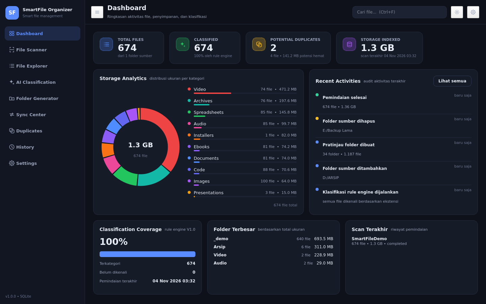
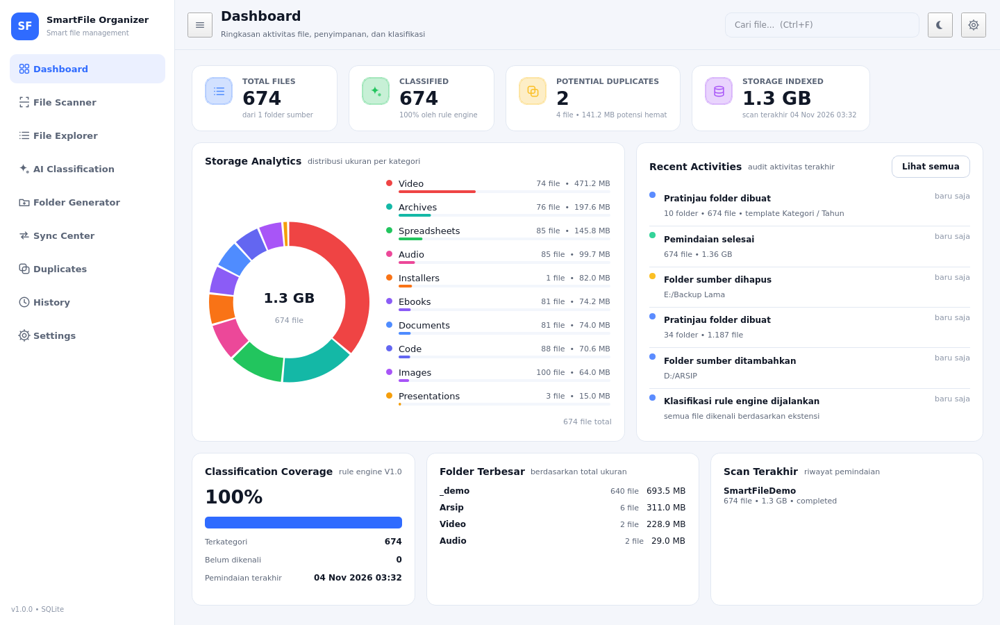
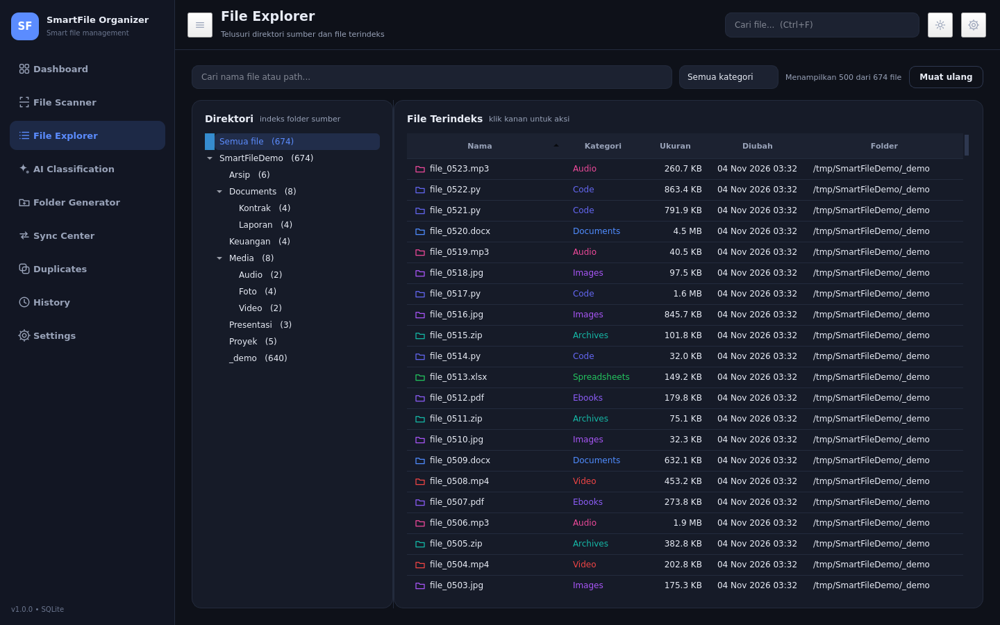
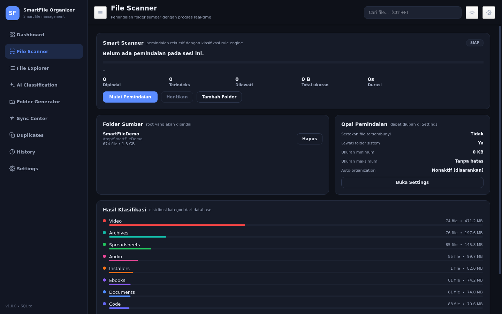
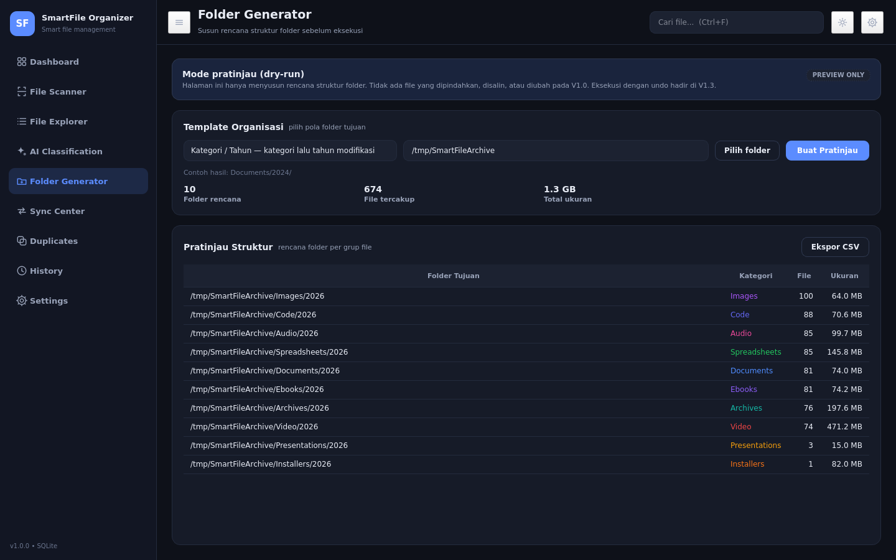

# SmartFile Organizer

**Intelligent File Management & Synchronization System** — aplikasi desktop untuk memindai,
mengklasifikasikan, dan (mulai V1.2) menata file secara otomatis.

Dibangun dengan **Python + PySide6 + SQLite**. Sepenuhnya aplikasi native: tanpa browser,
tanpa server, dan seluruh data index tersimpan lokal di komputer pengguna.



| Light Mode | File Explorer |
| --- | --- |
|  |  |

| File Scanner | Folder Generator |
| --- | --- |
|  |  |

---

## Status: V1.0 selesai dan dapat dijalankan

| Komponen dashboard | Fungsi | Status |
| --- | --- | --- |
| Overview | Ringkasan aktivitas file, penyimpanan, klasifikasi | **Aktif (V1.0)** |
| File Explorer | Melihat direktori sumber dan file terindeks | **Aktif (V1.0)** |
| Smart Scanner | Memindai seluruh file dengan progres real-time | **Aktif (V1.0)** |
| AI Classification | Klasifikasi cerdas (rule engine aktif, AI menyusul) | Sebagian (V1.0) → AI di V1.1 |
| Folder Generator | Membuat struktur folder (pratinjau dry-run) | Pratinjau (V1.0) → eksekusi V1.2/V1.3 |
| Synchronization | Sinkronisasi otomatis dan manual | Rencana V1.4 |
| Duplicate Manager | Mengelola file duplikat | Deteksi dini (V1.0) → aksi V1.5 |
| Document Relationship | Keterkaitan dokumen | Rencana V1.6 |
| Version History | Riwayat perubahan | Activity log aktif (V1.0) → versi dokumen V1.6 |
| Activity Log | Audit aktivitas | **Aktif (V1.0)** |
| Settings | Pengaturan sistem | **Aktif (V1.0)** |

### Yang sudah berfungsi penuh di V1.0

- **Database SQLite** dengan skema file, folder sumber, sesi pemindaian, dan log aktivitas.
- **Smart Scanner** multi-folder, rekursif, berjalan di thread terpisah (UI tidak membeku),
  mendukung pembatalan, filter ukuran, serta opsi melewati folder sistem dan file tersembunyi.
- **Rule engine klasifikasi** 10 kategori berbasis ekstensi (>150 ekstensi terdaftar).
- **Dashboard interaktif**: kartu metrik adaptif, donut chart penyimpanan, breakdown kategori,
  feed aktivitas, folder terbesar, dan riwayat pemindaian.
- **File Explorer** dengan pohon direktori, pencarian instan, filter kategori, pengurutan tabel,
  dan aksi klik kanan (buka file, buka folder, salin path).
- **Folder Generator (dry-run)** yang menyusun rencana struktur folder dan mengekspornya ke CSV.
- **Dark Mode & Light Mode** dengan token warna terpusat, dapat diganti tanpa restart.
- **Settings** untuk folder sumber/tujuan, opsi pemindaian, dan pemeliharaan database.
- **Keyboard shortcuts**: `Ctrl+1..9` navigasi, `Ctrl+F` cari, `Ctrl+R` muat ulang,
  `Ctrl+Shift+T` ganti tema, `Ctrl+B` lipat sidebar.
- **Adaptive layout**: kartu menyesuaikan lebar jendela, sidebar otomatis menjadi mode ikon
  saat jendela lebih sempit dari 1180 px.

---

## Menjalankan aplikasi

### Windows (paling mudah)

```bat
run_windows.bat
```

Skrip tersebut membuat virtual environment, memasang dependensi, lalu menjalankan aplikasi.

### Manual (Windows / Linux / macOS)

```bash
python -m venv .venv
# Windows: .venv\Scripts\activate
source .venv/bin/activate

pip install -r requirements.txt
python main.py
```

Prasyarat: **Python 3.10+**. Linux memerlukan paket sistem Qt standar
(`libgl1`, `libxkbcommon0`, `libdbus-1-3`, `libegl1`) agar PySide6 dapat membuka jendela.

### Opsi command line

```bash
python main.py --db "D:/data/smartfile.db"   # lokasi database khusus
python main.py --theme light                 # mulai dengan Light Mode
python main.py --reset                       # kosongkan indeks sebelum dibuka
python main.py --version
```

Lokasi database default:

| OS | Path |
| --- | --- |
| Windows | `%APPDATA%\SmartFileOrganizer\smartfile.db` |
| macOS | `~/Library/Application Support/SmartFileOrganizer/smartfile.db` |
| Linux | `~/.local/share/smartfile-organizer/smartfile.db` |

Bisa diubah lewat `--db` atau variabel lingkungan `SMARTFILE_DATA_DIR`.

---

## Alur pemakaian V1.0

1. Buka **Settings** (atau **File Scanner**) dan tambahkan **folder sumber**.
2. Atur **folder tujuan** (opsional) dan **opsi pemindaian**.
3. Jalankan **Mulai Pemindaian** di halaman *File Scanner* — progres, jumlah file,
   ukuran, dan durasi tampil langsung.
4. Tinjau hasil di **Dashboard**, lalu telusuri detail di **File Explorer**.
5. Gunakan **Folder Generator** untuk melihat pratinjau struktur folder yang diusulkan
   dan mengekspornya ke CSV.

> **Prinsip keamanan.** AI tidak boleh mengambil keputusan pemindahan file tanpa
> persetujuan pengguna pada tahap awal penggunaan. V1.0 sama sekali tidak memindahkan,
> menyalin, atau menghapus file. Setelah aturan klasifikasi dianggap stabil, pengguna
> dapat mengaktifkan Auto-Organization untuk kategori tertentu (V1.2+).

---

## Struktur proyek

```text
NEWPROJECT/
├── main.py                      # entry point: argparse, QApplication, MainWindow
├── smartfile.spec               # konfigurasi PyInstaller (onedir, windowed)
├── requirements.txt             # dependensi runtime
├── requirements-dev.txt         # + PyInstaller & ruff
├── run_windows.bat              # jalankan dari source (Windows)
├── assets/
│   ├── icon.png                 # ikon aplikasi
│   └── icon.ico                 # ikon untuk EXE
├── app/
│   ├── constants.py             # metadata app, kategori, roadmap, prinsip keamanan
│   ├── database.py              # lapisan SQLite (settings, files, roots, scans, activity)
│   ├── classification.py        # rule engine + antarmuka untuk AI (V1.1)
│   ├── scanner.py               # ScanWorker (QThread), opsi & progres pemindaian
│   ├── organizer.py             # pembuat rencana folder + ekspor CSV
│   ├── theme.py                 # token warna & stylesheet dark/light
│   ├── icons.py                 # ikon garis yang digambar dengan QPainter
│   ├── utils.py                 # format ukuran, waktu, path, buka file manager
│   └── ui/
│       ├── main_window.py       # top bar, sidebar, stacked pages, shortcut, tema
│       ├── widgets/             # sidebar, kartu, chart, feed aktivitas, flow layout
│       └── pages/               # dashboard, scanner, explorer, classifier,
│                                # organizer, roadmap (sync/duplicates/history), settings
├── scripts/
│   ├── generate_icon.py         # membuat assets/icon.png & .ico
│   ├── preview_screenshots.py   # data demo + tangkapan layar dokumentasi
│   └── build_windows.ps1        # build EXE (onedir/onefile)
├── tests/
│   ├── test_core.py             # database, klasifikasi, organizer, utils
│   └── test_ui_smoke.py         # semua halaman, tema, pencarian, pemindaian
├── docs/
│   ├── ARCHITECTURE.md          # detail arsitektur & titik ekstensi
│   └── screenshots/             # gambar dokumentasi
└── README.md
```

---

## Skema database

```sql
settings(key, value, updated_at)                  -- preferensi aplikasi
roots(id, path, label, added_at, enabled)         -- folder sumber
files(id, path, name, folder, ext, category,      -- indeks file
      confidence, size, modified_at, indexed_at, root_path)
scans(id, root_path, started_at, finished_at,     -- riwayat pemindaian
      files_found, total_size, status)
activity(id, action, detail, level, created_at)   -- audit log (500 entri terakhir)
```

`files.path` bersifat unik sehingga pemindaian ulang bersifat *idempotent* (upsert).
Indeks tambahan tersedia untuk `category`, `folder`, `name`, `size`, dan `root_path`.

---

## Build menjadi `.exe`

```powershell
powershell -ExecutionPolicy Bypass -File scripts\build_windows.ps1
```

Menghasilkan `dist\SmartFileOrganizer\SmartFileOrganizer.exe` (mode *onedir*, tanpa jendela konsol).
Untuk satu file portabel:

```powershell
powershell -ExecutionPolicy Bypass -File scripts\build_windows.ps1 -OneFile
```

Mode *onedir* disarankan: startup lebih cepat dan lebih jarang memicu false positive antivirus.

---

## Test

```bash
python -m unittest discover -s tests -v
```

- `tests/test_core.py` — logika murni tanpa Qt (database, klasifikasi, rencana folder, utilitas).
- `tests/test_ui_smoke.py` — membuat semua halaman, mengganti tema, memindai folder nyata,
  dan membuat pratinjau organisasi (memakai `QT_QPA_PLATFORM=offscreen`).

Membuat ulang tangkapan layar dokumentasi:

```bash
QT_QPA_PLATFORM=offscreen python scripts/preview_screenshots.py
```

---

## Roadmap

| Versi | Fokus |
| --- | --- |
| **V1.0** | Dashboard, database, scanner, file explorer ✅ |
| V1.1 | Rule engine lanjutan + AI Classification (Ollama lokal / cloud API) |
| V1.2 | Automatic Folder Generator (pembuatan folder setelah persetujuan) |
| V1.3 | Copy, move, dan flexible organization + undo |
| V1.4 | Automatic & manual synchronization (Watchdog, penjadwalan) |
| V1.5 | Duplicate detection berbasis hash + pratinjau penghapusan |
| V1.6 | Version history dan document relationship |
| V2.0 | Enterprise features: multi-user, retensi, enkripsi, optimasi skala besar |

Rencana teknis per versi ada di [`docs/ARCHITECTURE.md`](docs/ARCHITECTURE.md).

---

## Batasan V1.0 (disengaja)

- Tidak ada operasi tulis ke file pengguna: tidak ada move, copy, atau delete.
- Klasifikasi masih murni berbasis ekstensi; file tanpa ekstensi masuk kategori `Other`.
- "Potential duplicates" memakai pencocokan **nama + ukuran**, belum hash — bisa menghasilkan
  positif palsu, karena itu tidak ada tombol hapus.
- Sinkronisasi, version history, dan document relationship masih berupa halaman roadmap.
- Fokus platform: Windows (build EXE). Source tetap berjalan di Linux/macOS untuk pengembangan.

---

## Lisensi

Belum ditetapkan. Tambahkan berkas `LICENSE` sebelum distribusi publik.
